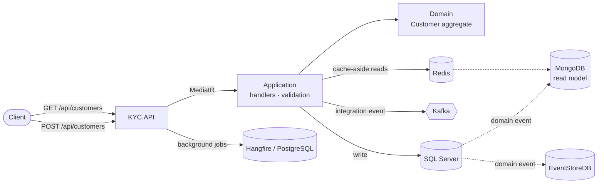

# KYC Service

A customer-registration ("Know Your Customer") microservice built with **.NET 10**, **ASP.NET Core**, and
the patterns that make large systems maintainable:

- **Domain-Driven Design** — an aggregate (`Customer`) that enforces its own rules, plus value objects and domain events
- **Clean Architecture** — dependencies point inward: `API → Infrastructure → Application → Domain`
- **CQRS** — writes go to SQL Server, reads come from MongoDB, joined by domain events
- **Event-driven architecture** — domain events inside the service, integration events (Kafka) to other services
- **Event store** — every domain event is appended to EventStoreDB
- **Distributed caching** (Redis) and **background jobs** (Hangfire on PostgreSQL)



## Quick start

You need [Docker](https://docs.docker.com/get-docker/) with Compose v2. Nothing else — the SDK runs inside the build container.

```bash
cd src/microservices/KYC
cp .env.example .env          # then edit the two passwords in .env
docker compose up --build     # API on http://localhost:8080
```

Register a customer and read it back:

```bash
curl -i -X POST http://localhost:8080/api/customers \
  -H 'Content-Type: application/json' \
  -d '{"firstName":"Ada","lastName":"Lovelace","dob":"1990-05-17",
       "customerAddress":{"street":"12 St James Square","city":"London","country":"United Kingdom","zipCode":"SW1Y 4JH"}}'
# HTTP/1.1 201 Created
# Location: http://localhost:8080/api/Customers/3f2c9d0e-...
# {"id":"3f2c9d0e-..."}

curl http://localhost:8080/api/customers/3f2c9d0e-...
curl http://localhost:8080/api/customers
```

More examples (validation errors, background jobs, health checks) are in [`docs/api.md`](docs/api.md) and in the
runnable [`KYC.API.http`](src/Presentation/KYC.API/KYC.API.http) file.

## Documentation

| Document | What's in it |
|---|---|
| [Getting started](docs/getting-started.md) | Run with Docker, run from the IDE, user-secrets, EF migrations, troubleshooting |
| [Architecture](docs/architecture.md) | Layers, the write and read flows, events, consistency trade-offs, data stores |
| [API reference](docs/api.md) | Every endpoint with request/response examples and the error format |
| [Configuration](docs/configuration.md) | Every setting, environment-variable mapping, secrets handling |
| [Testing](docs/testing.md) | The test pyramid, how to run each kind, how to write new tests, load testing |
| [Code review findings](docs/review-findings.md) | What the review found, what was fixed, what is still open |
| [Upgrading to .NET 10](docs/upgrading-to-net10.md) | What changed, breaking changes, migration checklist |
| [Architecture decisions](docs/adr) | Short records of the key decisions and why |

## Repository layout

```text
KYC/
├── src/
│   ├── Core/KYC.Domain/                         Customer aggregate, Address value object, domain events (no dependencies)
│   ├── Application/KYC.Application/             Commands, queries, handlers, validators, pipeline behaviors
│   ├── Infrastructures/
│   │   ├── KYC.Write.MsSql.Infrastructure/      EF Core + SQL Server (write model, migrations, unit of work)
│   │   ├── KYC.Read.Mongo.Infrastructure/       MongoDB read model and the event handler that fills it
│   │   ├── KYC.RedisCache.Infrastructure/       Redis-backed ICacheService
│   │   └── KYC.EventStore.EventStoreDB.Infrastructure/   Appends domain events to EventStoreDB
│   └── Presentation/KYC.API/                    Controllers, error handling, health checks, Program.cs
├── tests/
│   ├── KYC.Domain.UnitTests/                    Aggregate and value-object rules
│   ├── KYC.Application.UnitTests/               Handlers, validators, pipeline behavior (mocked ports)
│   ├── KYC.Infrastructure.UnitTests/            Read-model projection, DI validation, EF model vs migrations
│   ├── KYC.Infrastructure.IntegrationTests/     Real SQL Server, MongoDB, Redis in Docker (Testcontainers)
│   ├── KYC.API.Tests/                           The real HTTP pipeline, in memory, no Docker
│   ├── KYC.EndToEndTests/                       Black-box tests against the running compose stack
│   └── load/k6/customers.js                     k6 load test (smoke / load / stress / spike)
├── docs/                                        You are here
├── Dockerfile · docker-compose.yml · .env.example
└── Directory.Build.props · Directory.Packages.props · global.json · KYC.slnx
```

## Common commands

```bash
dotnet build KYC.slnx
dotnet test  KYC.slnx --filter "Category!=Integration&Category!=E2E"   # fast: unit + in-memory API tests
dotnet test  tests/KYC.Infrastructure.IntegrationTests                  # needs Docker
docker compose up --build -d && KYC_E2E_BASE_URL=http://localhost:8080 dotnet test tests/KYC.EndToEndTests
docker compose --profile loadtest run --rm k6                           # load test (smoke)
```

## Security note

Earlier revisions of this repository committed development passwords in `appsettings.*.json`. They are removed
from the current files but remain in git history — **treat them as compromised and rotate them** wherever they
were ever used. Secrets now come from `.env` (git-ignored), user-secrets, or environment variables; see
[`docs/configuration.md`](docs/configuration.md).
