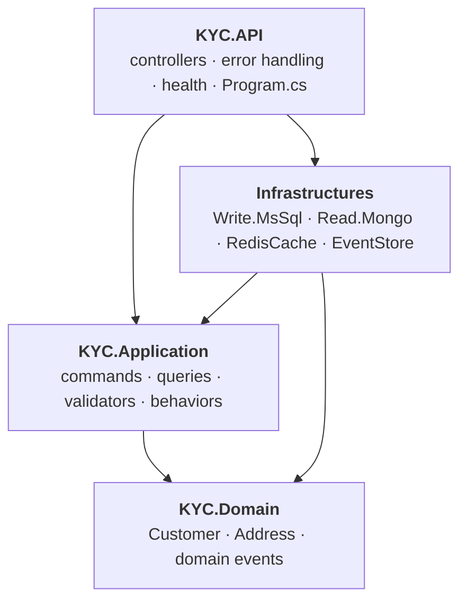
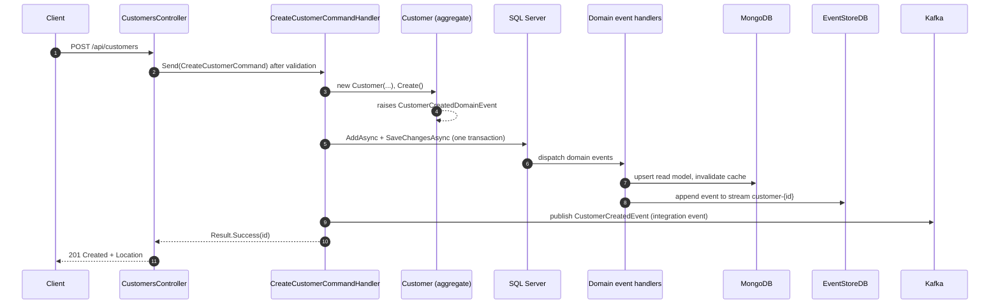

# Architecture

## Layers

Dependencies point inward. The Domain knows nothing about databases, HTTP or Kafka.

| Layer | Responsibility | Must not |
|---|---|---|
| Domain | Invariants (name length, date-of-birth range), domain events | Reference EF, Mongo, HTTP, MediatR handlers |
| Application | Use cases as MediatR commands/queries; FluentValidation; pipeline behaviors; ports (`ICommandRepository`, `IUnitOfWork`, `IEventProducer`, `ICacheService`, `IReadDbContext`) | Know which database or broker is behind a port |
| Infrastructure | Implements the ports; one project per technology | Contain business rules |
| API | HTTP mapping, problem-details, health, composition root | Contain business rules |

## Request pipeline

Every command and query passes through MediatR behaviors in this order:

`LoggingBehavior → ValidationBehavior → handler`

`ValidationBehavior` runs all FluentValidation validators for the request and throws
`ValidationException`; `GlobalExceptionHandler` turns that into an RFC 9457 `400` response listing the failing fields.

## Write flow (create a customer)

Key points:

- The aggregate is the only place that decides whether a customer is valid.
- The integration event is published **after** the SQL commit, so a rolled-back write is never announced.
- A broker outage is logged and does **not** fail the request (the customer exists). See [consistency](#consistency).

## Read flow

`GET /api/customers/{id}` and `GET /api/customers` use cache-aside:

1. Look in Redis (`customer:{id}` / the list key).
2. On a miss, read MongoDB, store the result with the configured expirations, return it.
3. Domain-event handlers invalidate the relevant cache keys when the read model changes.

The query side never touches SQL Server.

## Data stores

| Store | Role | Why |
|---|---|---|
| SQL Server (EF Core) | Source of truth for writes | Transactions, constraints |
| MongoDB | Denormalized read model | Fast reads shaped like the API response |
| Redis | Cache in front of MongoDB | Offload hot reads |
| EventStoreDB | Append-only audit trail of domain events | History and replay |
| Kafka | Integration events to other services | Decoupling |
| PostgreSQL | Hangfire job storage | Background jobs (`POST /api/customers/async`) |

## Consistency

The write and read models are **eventually consistent by construction**, and the code is honest about it:

- The read model is updated by a domain-event handler right after the SQL save. If that update fails, the error is logged
  (`Failed to project ...`) and the customer is in SQL but not (yet) in MongoDB.
- Likewise a failed Kafka publish is logged, not retried.
- There is **no outbox** yet, so neither case is repaired automatically.

For production use, add a transactional outbox (write the event to SQL in the same transaction and have a background
relay deliver it to MongoDB/Kafka with retries). That is the single most valuable next architectural step; see
[review findings](review-findings.md#open) and [ADR 0003](adr/0003-integration-event-publishing.md).

## Cross-cutting

- **Time:** code takes a `TimeProvider`, so tests control "now".
- **Errors:** `Result<T>` for expected outcomes (not found, save failed); exceptions for programmer/infrastructure errors.
- **Health:** `/health/live` (process up), `/health/ready` (SQL Server and Redis reachable).
- **Observability:** structured logging with no personal data in log messages.
